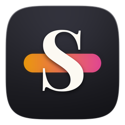
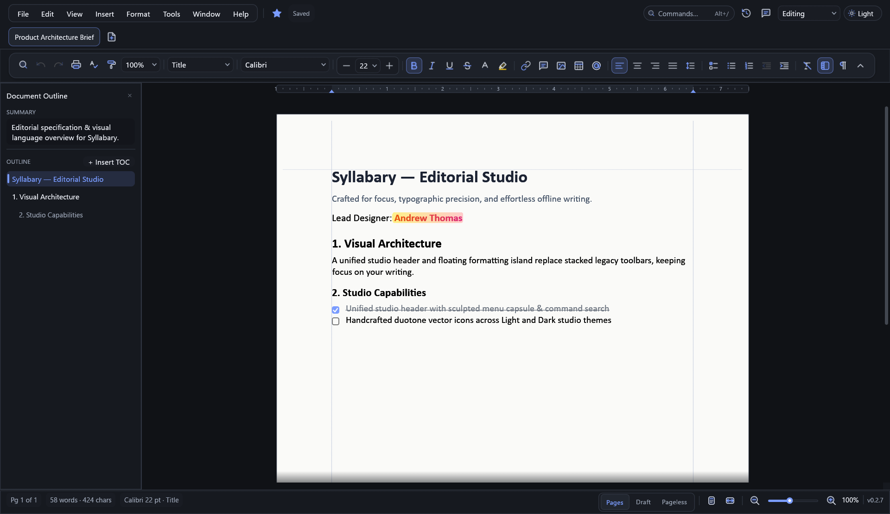
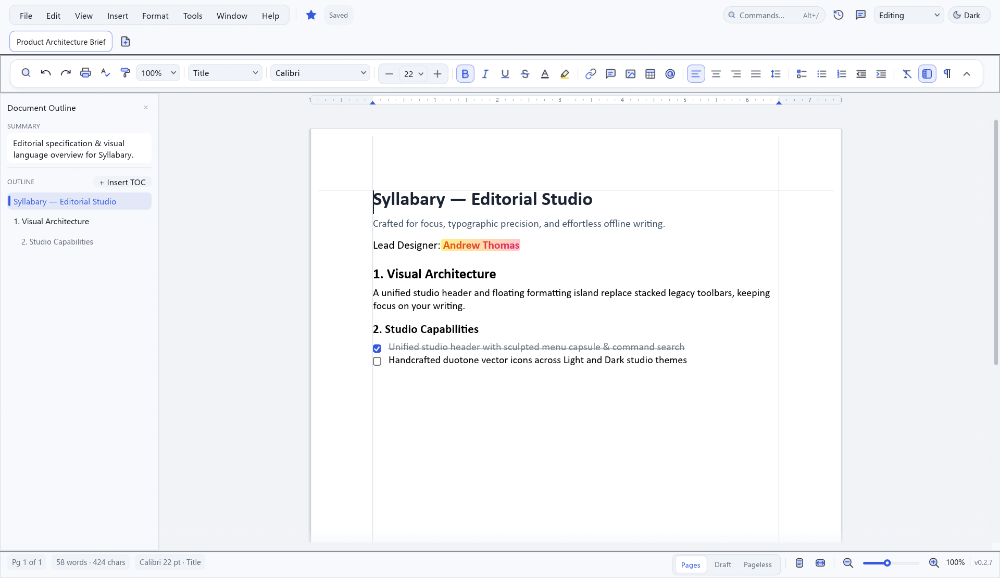
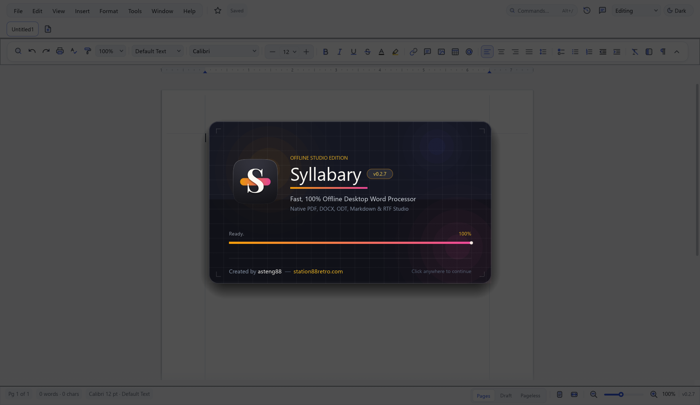

<div align="center">



# Syllabary

**A fast, standalone, 100% offline desktop word processor and PDF / DOCX / ODT studio built in Rust.**

[](https://github.com/asteng88/Syllabary/releases/latest)
[](LICENSE)
[](https://www.rust-lang.org/)
[](#-installation)
[](SECURITY.md)

[Download Latest Release](https://github.com/asteng88/Syllabary/releases/latest) · [Features](#-features) · [Screenshots](#-screenshots) · [Installation](#-installation) · [Building from Source](#-building-from-source) · [Contributing](CONTRIBUTING.md)

</div>

---

## About Syllabary

**Syllabary** is a modern, native desktop word processor crafted for writers, engineers, and everyday document workflows who want the polish of a contemporary studio editor **without** cloud lock-in, subscriptions, Electron bloat, or telemetry.

Written from the ground up in **Rust** (`eframe` / `egui`), Syllabary launches in milliseconds, renders crisp typography with **17 bundled open-source fonts**, edits `.docx`, `.odt`, `.pdf`, `.md`, `.rtf`, `.gdoc`, `.txt`, and native `.wpx` files directly on your machine, and ships with a dedicated cross-platform GUI installer for **Windows** and **Linux**.

---

## Screenshots

<div align="center">

### Dark Studio Theme


<br />

### Light Studio Theme


<br />

### Animated Obsidian Studio Splash Screen


</div>

---

## Features

### Native Multi-Format Document Studio
| Format | Read | Edit | Export | Notes |
| :--- | :---: | :---: | :---: | :--- |
| **`.wpx`** (Syllabary Native) | ✅ | ✅ | ✅ | Lossless native studio format with comments, history & styling |
| **`.docx`** (Microsoft Word) | ✅ | ✅ | ✅ | Tables, shading, borders, headers/footers, lists & embedded images |
| **`.odt`** (OpenDocument Text) | ✅ | ✅ | ✅ | Pure-Rust ODF 1.2 (ISO/IEC 26300) reader & writer |
| **`.pdf`** (Portable Document) | ✅ | ✅ | ✅ | Pixel-accurate `hayro` **Read** mode, in-place **Edit** mode, & `krilla` calibrated sRGB vector PDF export |
| **`.md`** (Markdown) | ✅ | ✅ | ✅ | Full Markdown import/export + live Markdown auto-formatting |
| **`.rtf`** (Rich Text Format) | ✅ | ✅ | ✅ | Rich styling, tables & legacy document interoperability |
| **`.gdoc`** / **`.txt`** | ✅ | ✅ | ✅ | Seamless Google Docs & UTF-8/UTF-16/Windows-1252 plain text support |

### Modern Studio Interface & Productivity
- **Light & Dark Studio Themes** with a floating Material Design 3 / Fluent pill toolbar and crisp vector icons.
- **Docked Right-Hand Studio Panels** (no intrusive popups): **Table Studio** (cell shading, borders, merge/split, `=SUM`/`=AVERAGE`/`=MEDIAN` formulas), **Headers & Footers** (All / First / Odd / Even page scopes + `{page}`, `{pages}`, `{date}`, `{title}` tokens), **Page Setup**, **Comments**, **Version History**, and **Settings**.
- **Search the Menus (`Alt+/`)** command palette, **`@` Smart Chips**, Checklists, Suggesting Mode, Bookmarks, Citations, and Live Word Count.
- **Non-Blocking Background Loading**: Large multi-page PDFs and documents load asynchronously on a worker thread with a live per-page progress overlay—zero UI freezes or `(Not Responding)` prompts.

### 100% Offline Privacy & Cross-Platform Native Integration
- **Offline Spell Checking**: Uses the inbox Windows OS spell checker on Windows and pure-Rust **Hunspell** (`spellbook`) with system dictionaries on Linux/Fedora, plus persistent custom user dictionaries.
- **17 Bundled Open-Source Fonts**: Works out of the box on both Windows and Linux with automatic metric-compatible font fallbacks and full system font discovery.
- **Native Printing**: Win32 `PrintDlgW` + GDI on Windows; CUPS (`lpstat`/`lp`/`lpr`) + `xdg-open` on Linux.
- **One-Click File Associations**: Per-user registration (no admin/root required) on both Windows (`HKCU`) and Linux (XDG `.desktop` + `xdg-mime`).
- **Built-in Auto-Updater**: Direct HTTPS + SHA-256 verified updates from GitHub Releases.

---

## Installation

### Option 1: Official GUI Installer (Recommended)

Download the installer for your OS from the [**Latest GitHub Release**](https://github.com/asteng88/Syllabary/releases/latest):

* **Windows:** Download and double-click **`syllabary-installer.exe`**
  * Installs to `%LOCALAPPDATA%\Programs\Syllabary\syllabary.exe` (no admin required)
  * Registers Start Menu, Windows Installed Apps, optional Desktop shortcut, user `PATH`, and file associations
* **Linux / Fedora:** Download **`syllabary-installer-linux`** and run:
  ```bash
  chmod +x ~/Downloads/syllabary-installer-linux
  ~/Downloads/syllabary-installer-linux
  ```
  * Installs to `~/.local/bin/syllabary` with `chmod +x` and SELinux `restorecon`
  * Installs the official icon and registers Syllabary in **Applications → Office**
  * Optional trusted Desktop shortcut and `xdg-mime` default file associations

### Option 2: Standalone Binary

Download `syllabary.exe` (Windows) or `syllabary-linux` (Linux / Fedora x86_64) directly from [**Releases**](https://github.com/asteng88/Syllabary/releases/latest).

On Linux / Fedora:
```bash
mkdir -p ~/.local/bin
cp ~/Downloads/syllabary-linux ~/.local/bin/syllabary
chmod +x ~/.local/bin/syllabary
~/.local/bin/syllabary
```

---

## Building from Source

### Windows
```powershell
cd app
cargo run --release
```

### Linux (Fedora)
```bash
# Install build & runtime dependencies
sudo dnf install gcc pkgconf-pkg-config libxkbcommon-devel wayland-devel \
  libX11-devel libXcursor-devel libXrandr-devel libXi-devel \
  mesa-libGL-devel fontconfig-devel gtk3-devel dbus-devel \
  cups xdg-utils hunspell-en-US

# Build & run Syllabary
cd app
cargo run --release
```

### Building the Cross-Platform Installer
```bash
cd installer
cargo build --release
```

---

## Repository Layout

```text
Syllabary/
├── app/                     # Main Syllabary desktop application (Rust / eframe / egui)
│   ├── src/                 # Editor, layout, PDF/DOCX/ODT/RTF/MD engines, splash, spellcheck, print
│   ├── assets/icons/        # App & document icons (.ico, .icns, Linux PNGs, .desktop)
│   └── fonts/               # 17 bundled open-source font families (OFL)
├── installer/               # Standalone cross-platform GUI installer (Windows & Linux)
│   ├── src/                 # GitHub Releases downloader (SHA-256), OS integration & UI
│   └── assets/              # Dedicated Syllabary Installer icon (.ico, .png)
├── docs/screenshots/        # Light, Dark & Splash Screen showcase images
├── CHANGELOG.md             # Release history
├── CONTRIBUTING.md          # Development setup & cross-platform contribution guide
├── SECURITY.md              # Privacy guarantee & vulnerability reporting
├── LICENSE                  # MIT License
└── VERSION                  # Single source of truth for application version
```

---

## Contributing

Contributions, bug reports, and feature ideas are warmly welcomed! Please read [CONTRIBUTING.md](CONTRIBUTING.md) before opening a pull request.

---

## License & Author

Released under the **[MIT License](LICENSE)**.

<div align="center">

Crafted with care by **[asteng88](https://github.com/asteng88)** — **[station88retro.com](https://station88retro.com)**

</div>
